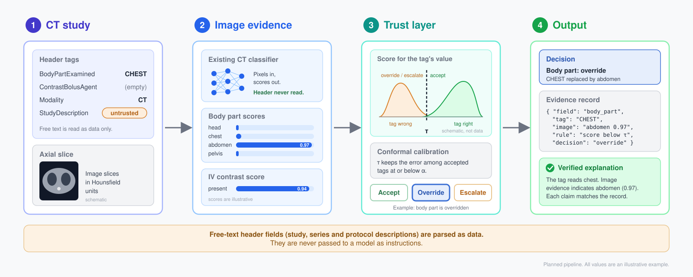

# Pixel2Claim

Trust decisions adapted to the DICOM header fields of CT studies.

DICOM headers include attributes like the body part studied and use of contrast agent. While these fields are essential for routing, cohort selection and dataset curation, they are often missing or inaccurate. Pixel2Claim compares each header field against evidence derived from the image and produces one of three decisions for each field: accept the tag, override the tag with the value derived from the image, or escalate to human review.

There is a record of evidence behind every decision. A deterministic verifier is used to check the natural language explanations generated from that record. Free-text header fields are treated as untrusted data, and are never provided to a model as instructions.



*Figure 1. Pixel2Claim Pipeline*

## Contributions

1. Per-field accept, override and escalate decisions with a stated error rate on accepted tags, measured on an image collection held out from calibration.
2. Explanations obtained from a documented evidence record and validated by a deterministic verifier, where accuracy is validated through evidence-removal experiments.
3. A pipeline where header free text cannot be used as an instruction, tested under adaptive prompt-injection attacks.

The predictions from the images are from a public CT body-part and a pre-trained contrast classifier. This work does not present a new classifier. Positioning in relation to earlier work is provided in `docs/00_claim.md`.

## Criteria

Step 0 of 8. Before any experiment is conducted, the claims and falsifying criteria are specified in `docs/00_claim.md`.

## Plan

| Step | Description | Location |
|---|---|---|
| 0 | Claims and falsification criteria | `docs/` |
| 1 | Data from the NCI Imaging Data Commons | `experiments/01_data.py` |
| 2 | Pixel oracle and trust-the-tags baseline | `experiments/02_oracle.py` |
| 3 | Corruption engine | `experiments/03_corruption.py` |
| 4 | Trust layer with conformal calibration | `experiments/04_trust.py` |
| 5 | Evidence records and verified explanations | `experiments/05_explain.py` |
| 6 | Adversarial evaluation | `experiments/06_attacks.py` |
| 7 | Evaluation, latency and cost | `experiments/07_eval.py` |
| 8 | Packaging and demonstration | `experiments/08_demo.py` |

## Installation

```bash
pip install -e .
pytest
```

The code runs on Google Colab and Kaggle.

## Data

Imaging data are publicly available, anonymous CT collections from The Cancer Imaging Archive, accessed through the NCI Imaging Data Commons and used in accordance with the TCIA Data Usage Policy. This repository contains no imaging data. The `data/` directory is ignored in version control.

## Intended use

Pixel2Claim is designed under deployment constraints (CPU inference, no network calls, an audit record for every decision, escalation by default), which are measured in the evaluation. It has not been validated on clinical data yet. 
